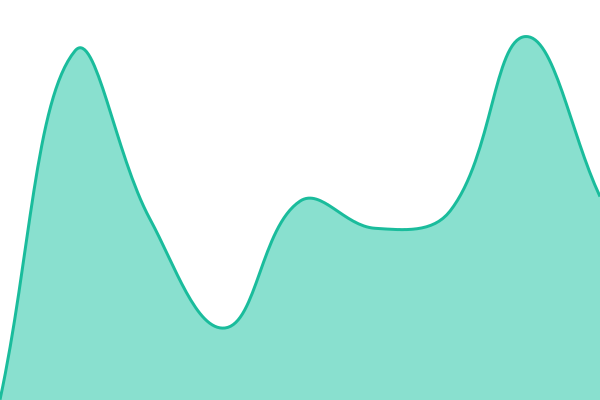
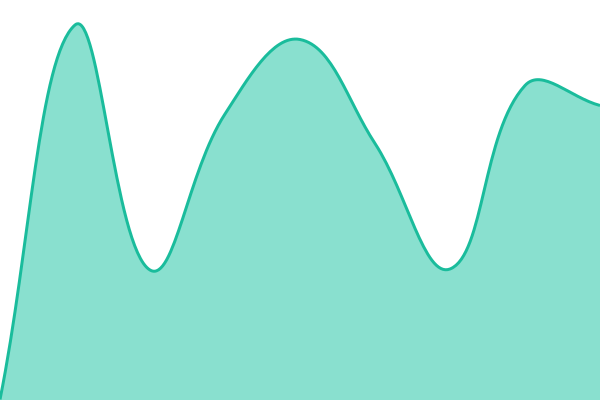

# [📈 Live Status](https://HappyGroupHub.github.io/playfuni-status-data): <!--live status--> **🟩 All systems operational**

This repository contains the open-source uptime monitor and status page for [LD Chi](https://davidbuy.com), powered by [Upptime](https://github.com/upptime/upptime).

With [Upptime](https://upptime.js.org), you can get your own unlimited and free uptime monitor and status page, powered entirely by a GitHub repository. We use [Issues](https://github.com/HappyGroupHub/playfuni-status-data/issues) as incident reports, [Actions](https://github.com/HappyGroupHub/playfuni-status-data/actions) as uptime monitors, and [Pages](https://HappyGroupHub.github.io/playfuni-status-data) for the status page.

<!--start: status pages-->
<!-- This summary is generated by Upptime (https://github.com/upptime/upptime) -->
<!-- Do not edit this manually, your changes will be overwritten -->
<!-- prettier-ignore -->
| URL | Status | History | Response Time | Uptime |
| --- | ------ | ------- | ------------- | ------ |
|  [Minecraft Server](https://www.doomhosting.com/api/query/minecraft?host=playfuni.net) | 🟩 Up | [minecraft.yml](https://github.com/HappyGroupHub/playfuni-status-data/commits/HEAD/history/minecraft.yml) | 

 6852ms
     
 | 

<a href="https://HappyGroupHub.github.io/playfuni-status-data/history/minecraft">100.00%</a>
    

|  [Official Website](https://www.playfuni.net) | 🟩 Up | [website.yml](https://github.com/HappyGroupHub/playfuni-status-data/commits/HEAD/history/website.yml) | 

 613ms
     
 | 

<a href="https://HappyGroupHub.github.io/playfuni-status-data/history/website">100.00%</a>
    

|  [DavidBuy](https://davidbuy.com) | 🟩 Up | [davidbuy.yml](https://github.com/HappyGroupHub/playfuni-status-data/commits/HEAD/history/davidbuy.yml) | 

 1174ms
     
 | 

<a href="https://HappyGroupHub.github.io/playfuni-status-data/history/davidbuy">100.00%</a>
    

|  [FunI Payment Website](https://funipay.net) | 🟩 Up | [funipay-website.yml](https://github.com/HappyGroupHub/playfuni-status-data/commits/HEAD/history/funipay-website.yml) | 

 189ms
     
 | 

<a href="https://HappyGroupHub.github.io/playfuni-status-data/history/funipay-website">100.00%</a>
    

|  [FunI Payment Bot](https://discord.com/api/guilds/1290755665005903942/widget.json) | 🟩 Up | [funipay-bot.yml](https://github.com/HappyGroupHub/playfuni-status-data/commits/HEAD/history/funipay-bot.yml) | 

 235ms
     
 | 

<a href="https://HappyGroupHub.github.io/playfuni-status-data/history/funipay-bot">100.00%</a>
    

|  [FunI Payment API](https://api.funipay.net/) | 🟩 Up | [funipay-api.yml](https://github.com/HappyGroupHub/playfuni-status-data/commits/HEAD/history/funipay-api.yml) | 

 713ms
     
 | 

<a href="https://HappyGroupHub.github.io/playfuni-status-data/history/funipay-api">100.00%</a>
    

|  [FunI Payment Dashboard](https://dashboard.funipay.net) | 🟩 Up | [funipay-dashboard.yml](https://github.com/HappyGroupHub/playfuni-status-data/commits/HEAD/history/funipay-dashboard.yml) | 

 1459ms
     
 | 

<a href="https://HappyGroupHub.github.io/playfuni-status-data/history/funipay-dashboard">100.00%</a>
    

|  [FunI Payment Docs](https://docs.funipay.net) | 🟩 Up | [funipay-docs.yml](https://github.com/HappyGroupHub/playfuni-status-data/commits/HEAD/history/funipay-docs.yml) | 

 190ms
     
 | 

<a href="https://HappyGroupHub.github.io/playfuni-status-data/history/funipay-docs">100.00%</a>
    

|  [CarTunes Web](https://cartunes.playfuni.net) | 🟩 Up | [cartunes-web.yml](https://github.com/HappyGroupHub/playfuni-status-data/commits/HEAD/history/cartunes-web.yml) | 

 687ms
     
 | 

<a href="https://HappyGroupHub.github.io/playfuni-status-data/history/cartunes-web">100.00%</a>
    

|  [CarTunes LINE Bot](https://linebot.playfuni.net/cartunes/) | 🟩 Up | [cartunes-linebot.yml](https://github.com/HappyGroupHub/playfuni-status-data/commits/HEAD/history/cartunes-linebot.yml) | 

 677ms
     
 | 

<a href="https://HappyGroupHub.github.io/playfuni-status-data/history/cartunes-linebot">100.00%</a>
    

|  [CarTunes API](https://api.playfuni.net/cartunes/) | 🟩 Up | [cartunes-api.yml](https://github.com/HappyGroupHub/playfuni-status-data/commits/HEAD/history/cartunes-api.yml) | 

 672ms
     
 | 

<a href="https://HappyGroupHub.github.io/playfuni-status-data/history/cartunes-api">100.00%</a>
    

|  [LINE Discord Sync (LINE)](https://linebot.playfuni.net/discord-backup/) | 🟩 Up | [sync-line.yml](https://github.com/HappyGroupHub/playfuni-status-data/commits/HEAD/history/sync-line.yml) | 

 574ms
     
 | 

<a href="https://HappyGroupHub.github.io/playfuni-status-data/history/sync-line">100.00%</a>
    

|  [LINE Discord Sync (Discord)](https://discord.com/api/guilds/1290755665005903942/widget.json) | 🟩 Up | [sync-discord.yml](https://github.com/HappyGroupHub/playfuni-status-data/commits/HEAD/history/sync-discord.yml) | 

 83ms
     
 | 

<a href="https://HappyGroupHub.github.io/playfuni-status-data/history/sync-discord">100.00%</a>
    

|  [TWQR Generator](https://twqr-generator.playfuni.net) | 🟩 Up | [twqr.yml](https://github.com/HappyGroupHub/playfuni-status-data/commits/HEAD/history/twqr.yml) | 

 424ms
     
 | 

<a href="https://HappyGroupHub.github.io/playfuni-status-data/history/twqr">100.00%</a>
    

|  [FingerWHO](https://fingerwho.playfuni.net) | 🟩 Up | [fingerwho.yml](https://github.com/HappyGroupHub/playfuni-status-data/commits/HEAD/history/fingerwho.yml) | 

 167ms
     
 | 

<a href="https://HappyGroupHub.github.io/playfuni-status-data/history/fingerwho">100.00%</a>
    

|  [1365 Poker House](https://poker.playfuni.net) | 🟩 Up | [poker.yml](https://github.com/HappyGroupHub/playfuni-status-data/commits/HEAD/history/poker.yml) | 

 655ms
     
 | 

<a href="https://HappyGroupHub.github.io/playfuni-status-data/history/poker">100.00%</a>
    

<!--end: status pages-->

[**Visit our status website →**](https://HappyGroupHub.github.io/playfuni-status-data)

## 📄 License

- Powered by: [Upptime](https://github.com/upptime/upptime)
- Code: [MIT](./LICENSE) © [Anand Chowdhary](https://anandchowdhary.com)
- Data in the `./history` directory: [Open Database License](https://opendatacommons.org/licenses/odbl/1-0/)
